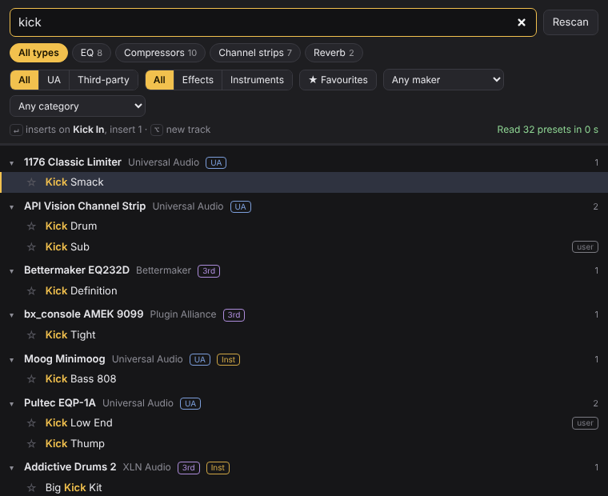

# Preset Finder for LUNA

Search every installed plugin's presets at once in [LUNA](https://www.uaudio.com/luna). Type
**kick** and see every preset with "kick" in its name, from UA and third-party plugins alike,
grouped by plugin. Click one to load it.



## Install

Requires **LUNA 3.1.2 or later** (macOS).

1. Download `preset-finder-<version>.lunaaddon` from the
   [latest release](https://github.com/midfield23/preset-finder/releases/latest).
2. With LUNA open, double-click the file and accept the prompt.
3. Open it from **Add Ons > Preset Finder**. It opens as a floating window; you can also dock it
   in LUNA's side browser or the editor pane under the Timeline.

The first time it opens it reads every plugin's presets from LUNA's preset library, which can
take a minute or two with a lot of plugins installed. After that it opens instantly.
Installing an update reads them again once.

## Using it

- **Search** as you type. Every word must appear in the preset name, the plugin name or the
  maker, so `kick 1176` finds the 1176's kick presets.
- **Type chips**: EQ, Compressors, Channel strips, Reverb, Delay, Saturation, Modulation and
  Amps, each with its preset count. Only types you have presets for are shown.
- **Compressor kinds**: choosing Compressors opens a second row: FET, Opto, VCA, Vari-Mu,
  Multiband, Limiter and Other. LUNA doesn't record what kind of compressor a plugin is, so
  Preset Finder **guesses from the plugin's name**: 1176 and Distressor are FET, LA-2A and CL 1B
  Opto, Fairchild and Manley Vari-Mu, SSL bus, API 2500 and dbx 160 VCA. Anything it can't tell
  is Other. The rules are in [`src/types.ts`](src/types.ts); corrections are welcome.
- **More filters**: UA or third-party, effects or instruments, favourites, maker, and LUNA's
  plugin category.
- **Loading** goes to the most sensible place:
  1. onto that plugin, if the selected track already has it;
  2. into the next free insert (or the empty instrument slot of an instrument track);
  3. otherwise onto a new track made from the preset.

  Hold **⌥ Option** while clicking to always make a new track. The line under the filters says
  where the highlighted preset will go. Each load is one undo step.
- **Favourites**: click the star. Presets starred in LUNA's own preset browser count too.
- **Recently used** presets show when the search box is empty.
- **Keys**: ↑ ↓ move, Return loads, ⌥Return loads onto a new track, Esc clears the search,
  `/` or ⌘F jumps to the search box.

Presets you save after the first launch appear after you press **Rescan**. Newly installed
plugins are picked up automatically.

## Building from source

Preset Finder is built with UA's
[LUNA Builder SDK](https://github.com/uaudio-labs/luna-builder-sdk), which isn't on npm, so
clone and build it next to this repository first:

```sh
git clone https://github.com/uaudio-labs/luna-builder-sdk
(cd luna-builder-sdk && npm install && npm run build)
git clone https://github.com/midfield23/preset-finder
cd preset-finder
npm install
npm test          # runs against the SDK's simulated LUNA, no LUNA needed
npm run pack      # writes preset-finder.lunaaddon
```

Source: `src/presetIndex.ts` reads and caches the presets, `src/search.ts` searches them,
`src/types.ts` sorts plugins into types, `src/loader.ts` decides where a preset goes,
`src/prefs.ts` keeps favourites and recents, and `src/main.ts` is the page.

## Licence

Apache License 2.0, the same as the LUNA Builder SDK it includes. See [LICENSE](LICENSE) and
[NOTICE](NOTICE). Not made or endorsed by Universal Audio. LUNA is a trademark of Universal
Audio, Inc.
